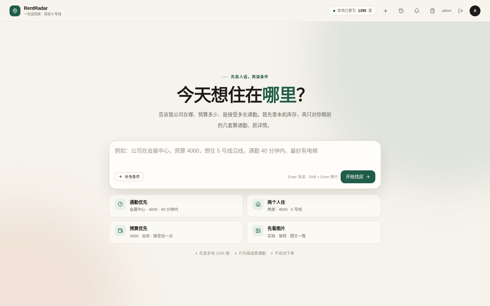
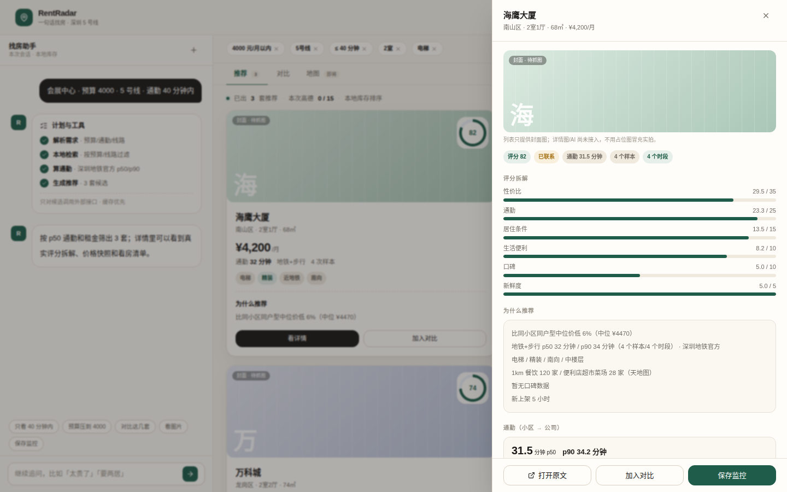
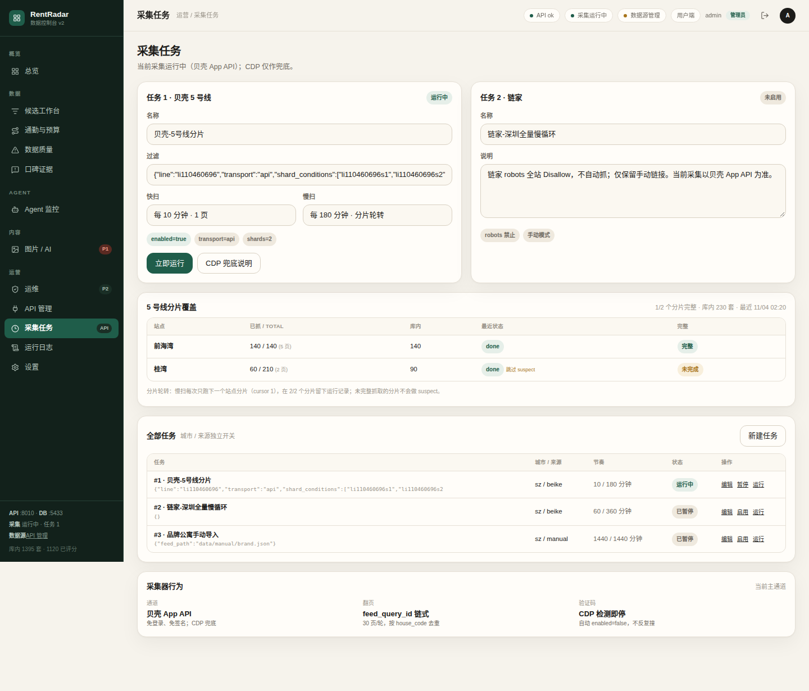
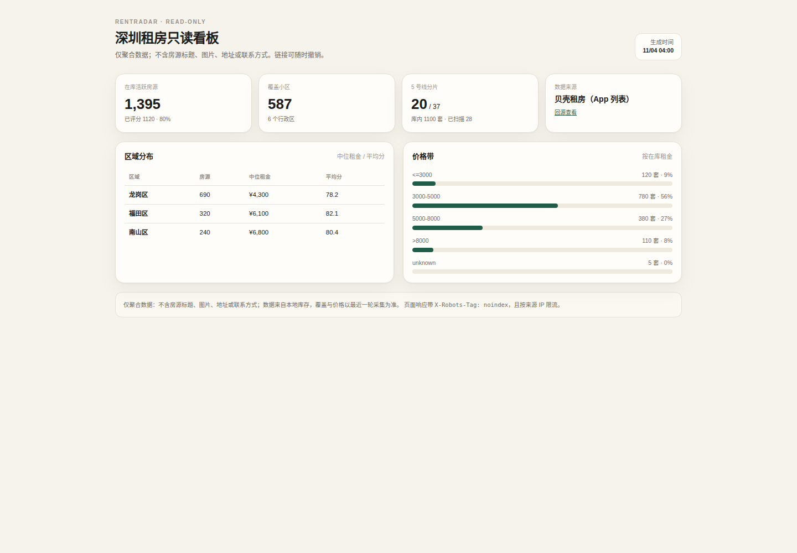

<div align="center">

# RentRadar

**深圳租房情报系统 · 采集 → 评分 → 对话 → 看板**

一句话找房 · 可解释评分 · 通勤 p50/p90 · 真实地图 · 只读分享


[项目概览](#1-项目概览) · [核心特性](#2-核心特性) · [界面](#3-界面) · [系统架构](#4-系统架构) · [快速开始](#7-快速开始) · [API](#8-api)

[部署与运维](#9-部署与运维) · [测试与验证](#10-测试与验证) · [已知限制](#11-已知限制与未验证事项) · [踩坑](#12-工程实践与踩坑) · [安全](#14-安全与合规) · [Roadmap](#15-roadmap)

</div>

> **项目状态：v0.1 / 单实例自用 / P0–P3 代码侧已收口。**
> 采集、评分、通勤、对话 Agent、地图、只读分享、告警与备份链路均已落地；
> 公开仓库只保留代码、文档和界面截图，**不含** `.env`、`.secrets/`、`data/`、数据库快照或任何生产密钥。
> 首次运行按第 7 节初始化；真实采集、地图、飞书和模型需要自备凭据，未配置时会自动降级。

**本地库存驱动** · **规则 + LLM 双模 Agent** · **每个分数有理由** · **CI 覆盖后端 / 迁移 / 前端**

---

## 目录

- [1. 项目概览](#1-项目概览)
- [2. 核心特性](#2-核心特性)
- [3. 界面](#3-界面)
- [4. 系统架构](#4-系统架构)
- [5. 采集、去重与评分](#5-采集去重与评分)
- [6. 对话 Agent](#6-对话-agent)
- [7. 快速开始](#7-快速开始)
- [8. API](#8-api)
- [9. 部署与运维](#9-部署与运维)
- [10. 测试与验证](#10-测试与验证)
- [11. 已知限制与未验证事项](#11-已知限制与未验证事项)
- [12. 工程实践与踩坑](#12-工程实践与踩坑)
- [13. 目录结构](#13-目录结构)
- [14. 安全与合规](#14-安全与合规)
- [15. Roadmap](#15-roadmap)
- [16. License](#16-license)

---

## 1. 项目概览

### 1.1 要解决的问题

租房决策的信息是分散的，而且大部分工作靠人肉完成：

- **房源分散在多个平台**：贝壳、自如、豆瓣、闲鱼……同一套房可能被重复发布；
- **价格和存活没有统一视图**：降价、下架、重新上架，靠每天手动刷很难跟住；
- **通勤、生活配套、口碑无法直接比较**：房源页不会告诉你地铁加步行要多久，也不会告诉你小区有没有隔音投诉；
- **真假房源混在一起**：重复封面、异常低价、中介话术，需要可解释的信号而不是黑箱结论；
- **每天刷房 1–2 小时，仍然会漏掉刚上架的好房**。

### 1.2 方案

RentRadar 把「发现 → 判断 → 行动 → 沉淀」做成一条闭环：

1. **采集**：贝壳 App 列表 API 为主通道，CDP 受控浏览器兜底，支持手动 JSON/CSV 导入与自如公开列表；
2. **去重与评分**：按 `house_code` 和跨源规则去重，用 100 分制输出可解释评分和 `score_reasons`；
3. **补齐判断维度**：天地图地理编码/POI、深圳地铁官方 SZMC 通勤、封面 dHash/假房源信号、口碑证据；
4. **对话 Agent**：一句话说清预算、通勤、户型、区域，Agent 在本地只读工具上检索、对比、解释；
5. **通知与分享**：飞书即时推送、09:00 日报、条件监控；只读聚合看板通过可撤销 token 分享；
6. **运维**：Provider 额度/熔断/调用审计、CI、告警、备份与恢复演练。

### 1.3 范围与边界

- 当前以 **深圳 5 号线沿线**为主要范围，城市、来源和任务均可在管理端配置；
- 定位是 **个人/小团队自用工具**，不是房源交易平台，不提供代看房、代签或撮合；
- 只读分享只输出自己生成的聚合字段，不公开房源标题、图片、地址或联系方式；
- 链家 `robots.txt` 全站 Disallow，**不做链家自动抓取**；不逆向贝壳详情，不自动把 `suspect` 改成 `gone`；
- 公开仓库不包含数据库文件、生产快照、房东/住户个人信息或任何密钥。

### 1.4 文档地图

| 文档 | 内容 |
|---|---|
| [`docs/P2-P4-COMPLETION.md`](docs/P2-P4-COMPLETION.md) | P2–P4 完成度、验收记录与仍需人工/生产数据的项 |
| [`docs/OPS.md`](docs/OPS.md) | CI、告警、备份恢复、只读分享与公网暴露边界 |
| [`docs/STALE-DATA-AUDIT.md`](docs/STALE-DATA-AUDIT.md) | 写死/非实时数据审计与修复顺序 |
| [`docs/TIANDITU-MAP.md`](docs/TIANDITU-MAP.md) | 天地图调研、瓦片代理与坐标系处理 |
| [`docs/DEVELOPMENT.md`](docs/DEVELOPMENT.md) | 开发与环境基线（部分早期设计已被实现取代） |
| [`docs/PROJECT.md`](docs/PROJECT.md) | v1.0 立项基线（仅历史参考） |
| [`docs/evidence/`](docs/evidence/) | 关键 UI 改动的前后对比截图与说明 |

---

## 2. 核心特性

| 能力 | 说明 | 代码入口 |
|---|---|---|
| **贝壳 App 列表采集** | `Rentplat/v2/house/list` 主通道，免登录免签名；带回 `feed_query_id` 翻页，按 `house_code` 去重 | `backend/app/sources/beike_api.py` |
| **CDP 兜底** | 受控浏览器在 API 不可用或需要登录态时接管；检测到人机验证立即停任务 | `backend/app/sources/cdp.py`、`beike.py` |
| **站点分片覆盖** | 按地铁线/站点生成筛选条件，慢扫每轮只跑一个分片，coverage 页显示每站已抓/total/库内 | `backend/app/services/shard_service.py`、`backend/app/cli.py` |
| **多源与手动导入** | `manual` JSON/CSV、`ziroom` 公开列表；跨源同房源按小区/户型/租金/面积去重 | `backend/app/sources/manual.py`、`ziroom.py`、`dedupe_service.py` |
| **100 分可解释评分** | 性价比 35 / 通勤 25 / 居住条件 15 / 生活便利 10 / 口碑 10 / 新鲜度 5，面积过小额外扣分 | `backend/app/services/score_service.py` |
| **通勤 p50/p90** | SZMC 官方地铁+步行路径，07:30/08:00/08:30/09:00 四个时段采样；时刻表无波动时明确标注 `static` | `backend/app/services/commute_service.py` |
| **天地图地图** | 服务端瓦片代理 + 磁盘缓存，Key 不下发浏览器；无 Key 时前端回退坐标网格 | `backend/app/services/map_service.py`、`integrations/maps/tianditu.py` |
| **封面与假房源信号** | 本地缓存封面、64-bit dHash、重复图/低价/中介话术信号；≥2 个信号才标记可疑 | `backend/app/services/image_service.py` |
| **口碑证据** | 人工录入/抽取草稿/确认/排除；verified 计分、uncertain 只展示、rejected 排除，180 天半衰期 | `backend/app/services/reputation_service.py` |
| **对话 Agent** | 规则 + LLM 双模：原生 `tool_calls`（开关）→ 严格 JSON 计划 → 规则兜底；单轮 4 步/6 次工具上限 | `backend/app/services/agent_service.py`、`agent_tools.py` |
| **只读工具运行时** | 6 个工具：检索、详情、对比、通勤、价格历史、保存监控（唯一写工具） | `backend/app/services/agent_tools.py` |
| **护栏** | PII 脱敏、提示注入拦截、AI 日额度硬停、工具步数/次数限制 | `backend/app/services/guardrails.py` |
| **可观测** | 每次工具调用落 `agent_tool_calls`；会话记录模型、token、延迟、fallback、护栏结果 | `backend/app/services/agent_service.py` |
| **评测** | 60 条 golden set（48 条查询 + 12 条护栏），管理端可跑规则基线并查看历史回归 | `backend/app/services/agent_eval_service.py`、`backend/app/data/agent_eval.json` |
| **监控与通知** | 新上架/重新上架/降价匹配，静默时段只累积 pending；飞书即时、日报、告警 | `backend/app/services/monitor_service.py`、`notify_service.py` |
| **只读分享** | token 只存 SHA-256，可撤销/过期，60 次/分/IP 限流，`noindex`，只返回聚合数据 | `backend/app/services/share_service.py` |
| **运维** | Provider 额度/熔断/调用审计、队列/源失败/磁盘/备份告警、备份/恢复演练 | `backend/app/services/provider_runtime.py`、`alert_service.py` |
| **鉴权** | JWT access Cookie + refresh 轮换、scrypt 密码、admin/viewer、审计日志 | `backend/app/services/auth_service.py` |
| **CI** | 后端 ruff + pytest、Postgres 16 迁移升降级、前端构建 | `.github/workflows/ci.yml` |

---

## 3. 界面

> 以下截图来自开发环境（本地 mock API，非生产数据），只用于展示界面结构与状态流转；
> 真实数据以本地库为准。更多前后对比见 [`docs/evidence/`](docs/evidence/)。

**用户端：一句话说清需求，Agent 先查本地库存，再给出候选与理由。**

<p align="center">
  
</p>

<p align="center"><sub>预算、公司位置、通勤、户型都可以在一句话里说；也可以点选示例。</sub></p>

**每条推荐都带评分拆解、价格快照、通勤 p50/p90、外卖样本和看房清单，不是一张黑箱卡片。**

<p align="center">
  
</p>

<p align="center"><sub>详情抽屉展示真实字段；分数由六个可解释分项组成，缺失样本会明确标注。</sub></p>

**管理端覆盖采集、候选、通勤、质量、口碑、Provider、Agent、图片、运维、任务、日志和设置。**

<p align="center">
  
</p>

<p align="center"><sub>5 号线分片覆盖、快慢扫节奏、任务启停与来源/城市维度；截图内数字来自演示数据。</sub></p>

**只读看板只发布聚合字段，链接可随时撤销。**

<p align="center">
  
</p>

<p align="center"><sub>总量、区域中位租金、价格带和分片摘要；不含标题、图片、地址或联系方式。</sub></p>

---

## 4. 系统架构

### 4.1 总览

```text
浏览器（Vue 3 SPA）
  ├─ /              用户端：一句话对话 + 结果画布 + 地图 + 看房清单
  ├─ /admin         管理端：总览/候选/通勤/质量/口碑/Provider/Agent/图片/运维/任务/日志/设置
  └─ /share/:token  公开只读聚合看板（可撤销、noindex、限流）

FastAPI (:8010，默认只绑 127.0.0.1 或局域网)
  ├─ /api/agent/*        SSE 对话、会话、监控
  ├─ /api/listings/*     列表、详情、看房清单、状态流转、CSV 导出
  ├─ /api/maps/*         小区聚合、站点、天地图瓦片代理与缓存
  ├─ /api/admin/*        BFF、Provider、任务、运维、分享、来源/城市、参考租金
  ├─ /api/public/*       只读分享（token + 限流）
  ├─ /api/auth/*         登录/刷新/登出/改密
  └─ /ws                 WebSocket 广播

Postgres 16（Alembic）
  ├─ scheduler：入队快扫/慢扫/日报/监控/告警
  └─ worker：SKIP LOCKED 消费 jobs，执行采集、补全、重评分、图片、通知

外部 Provider
  ├─ 贝壳 App API / CDP
  ├─ 天地图（地理编码 / POI / 瓦片）
  ├─ 深圳地铁官方 SZMC（地铁 + 步行）
  ├─ OpenCode Go（主模型）/ ModelScope（兜底）
  └─ 飞书（通知 / 告警）
```

### 4.2 进程模型

| 进程 | 职责 | 启动方式 |
|---|---|---|
| `rentradar-api` | FastAPI、SSE、静态 SPA、管理端 BFF | `uvicorn app.main:app` |
| `rentradar-worker` | 消费 `jobs`：采集、补全、重评分、图片分析、日报、监控、告警 | `python -m app.workers.worker` |
| `rentradar-scheduler` | 每 60 秒 tick：快扫/慢扫/日报/监控/告警入队 | `python -m app.workers.scheduler` |
| `rentradar-web`（可选） | Vite 开发服务器，`/api` 代理到 8010 | `npm run dev` |

- 队列使用 `SELECT … FOR UPDATE SKIP LOCKED`，多 worker 不会重复消费同一个 job；
- 任务连续 3 次失败后 scheduler 熔断跳过，单个任务异常不会中断整轮；
- 慢扫按站点分片轮转，只有分片 job 真正入队时才推进游标。

### 4.3 一次采集的完整过程

1. scheduler 按快/慢节奏入队 `crawl_fast` / `crawl_slow`；
2. worker 取任务与来源，选择 `api` 或 `cdp` 通道；
3. 解析列表页返回的房源草稿：价格、面积、户型、楼层、标签、坐标、封面、上架时间；
4. 按 `house_code` 去重；跨源候选再按小区/户型/租金/面积匹配，命中则记录 alias 而不新增；
5. 写入 `listings` 与 `snapshots`，产生新上架/重新上架/降价事件；
6. 执行硬过滤和评分，写入 `score_reasons`；随后按需补全通勤/POI/口碑；
7. 首次运行是基线：事件标记为已通知但不推送，避免冷启动刷屏；
8. 非基线事件按阈值、静默时段、每轮上限推送到飞书；
9. 管理端可查看 runs、覆盖率、失败原因和每站抓取进度。

### 4.4 数据平面

| 存储 | 职责 |
|---|---|
| `listings` / `snapshots` | 房源主表、价格/状态快照；`score` 与 `score_reasons` 物化 |
| `communities` / `poi_cache` / `commute_samples` | 小区坐标、1km POI 缓存、分时段通勤样本 |
| `listing_images` / `listing_image_analysis` | 封面缓存、dHash、重复/低价/话术信号、可选视觉标签 |
| `reputation_mentions` | 口碑证据、来源链接、置信度、确认/排除状态 |
| `tasks` / `jobs` / `runs` / `events` | 任务、队列、运行记录与通知事件 |
| `share_links` | 只读分享 token 的 SHA-256、过期时间、撤销状态 |
| `agent_sessions` / `agent_tool_calls` / `agent_monitors` | 会话、工具调用 trace、条件监控 |
| `provider_*` | Provider 设置、额度、健康与调用审计 |
| `users` / `auth_sessions` / `audit_log` | 登录、刷新会话与审计 |

### 4.5 模型供给

- **主模型**：OpenCode Go · `deepseek-v4.1-flash`（OpenAI 兼容 Chat Completions）；
- **兜底**：ModelScope · `deepseek-ai/DeepSeek-V4.1-Flash-1017`；
- **切换**：只改 `.env` 的 base URL / model / key，不改业务代码；
- **预算**：所有 AI Provider 共用 `aiDailyCap`，调用前检查额度，不足时整轮回退规则版；
- **原生工具**：`APP_AGENT_NATIVE_TOOLS=false` 默认关闭；开启后先走 `tool_calls`，失败回退严格 JSON，再回退规则；
- **降级顺序**：原生工具 → 严格 JSON 计划 → 规则计划；LLM 回答失败 → 规则回答；视觉标签关闭 → 只做 dHash/本地信号。

---

## 5. 采集、去重与评分

### 5.1 数据源

| 来源 | 方式 | 默认状态 | 说明 |
|---|---|---|---|
| 贝壳 | App 列表 API | 启用 | 主通道；免登录、免签名，坐标 GCJ-02 |
| 贝壳 | CDP 受控浏览器 | 兜底 | API 失效/需要登录态时使用；检测验证码即停 |
| 自如 | 公开列表 API | 停用 | 价格从 PNG 精灵图解码；需在管理端启用 |
| 手动导入 | JSON / CSV | 停用 | 通过任务 `feed_path` 或 `import-listings` 导入 |
| 链家 | — | 不自动抓取 | robots 全站 Disallow，只保留手动链接 |

### 5.2 采集通道

**贝壳 App API**：

- 单条件 `offset` 上限 2999，单页最多 30 条，5 号线全量无法一次抓完；
- 翻页必须回传上一页的 `feed_query_id`，否则 `offset` 可能返回同一批；
- 列表自带 GCJ-02 坐标，可直接回填小区坐标，减少地图调用；
- 同一轮按 `house_code` 去重，重复房源更新而不是新增；
- 当 `total > pages × 30` 时说明本轮未抓全，**跳过 `suspect` 判定**，避免误标下架。

**CDP 兜底**：

- 受控 Chrome 复用同一标签页，页间 6–12 秒；
- 检测到人机验证立即抛出 `CaptchaRequiredError` 并把任务置为停用；
- 只作为兜底，不作为默认高频通道。

### 5.3 去重与状态

- 同源：`house_code` 唯一；
- 跨源：同城市 + 规范化小区名 + 规范化户型 + 租金 ±3%（面积都有值时 ±5%）；
- 命中跨源重复时，在已存在房源上记录 alias，不新增重复行；
- 连续两次完整扫描未出现 → `suspect`；API 未抓全时跳过；
- **不自动把 `suspect` 改成 `gone`**，避免把「没扫到」误判成「已下架」；
- 首次运行是基线，new 事件不推送。

### 5.4 评分

| 维度 | 权重 | 数据来源 | 说明 |
|---|---|---|---|
| 性价比 | 35 | 同小区/同区同户型中位价；优先参考租金 | 样本不足时回落到同区，并在理由中说明 |
| 通勤 | 25 | SZMC 地铁+步行，4 个出发时段 | 评分取 p50，详情显示 p90/样本数；`static` 表示时刻表无时段波动 |
| 居住条件 | 15 | 标签、楼层、朝向、面积 | 电梯/精装/南向/中楼层/面积加分；<25㎡ 额外扣分 |
| 生活便利 | 10 | 1km 餐饮 + 便利店/超市/菜场 POI | 对数归一化，POI 过期后按 TTL 重采 |
| 口碑 | 10 | `reputation_mentions` 中 verified 证据 | 180 天半衰期；无证据显示「数据不足（中性分）」而不是编造分数 |
| 新鲜度 | 5 | `first_seen_at` | 6h 内满分，24h/72h 递减 |
| 风险 | 扣分 | 面积 <25㎡ | 最多扣 5 分，写入 `score_reasons.risk` |

- 每个分项都写入 `score_reasons.components` 和 `weights`，前端按真实值渲染；
- 缺失样本按中性分处理时，理由会明确写「缺失/估算」，不伪装成实测；
- 评分在采集/重算时物化，管理端可触发 `analysis` 重评分；公司或权重变化后需要重算。

### 5.5 站点分片

```bash
cd backend
python -m app.cli shards --line 5号线 --probe          # 探测每站 total 与跨站去重
python -m app.cli apply-shards --task-id 1 --line 5号线 # 写入分片计划 + 10/180 分钟调度
```

- 每个分片对应一个站点的筛选条件；
- 慢扫每轮只跑一个分片，跑完推进游标；
- 管理端「采集任务」页显示每站已抓/total/库内/完整状态；
- 覆盖率是数据验收项：需要生产环境持续跑完整个轮转周期，不以本地 mock 代替。

---

## 6. 对话 Agent

### 6.1 一次提问的完整过程

```text
用户输入（中文一句话）
   │
   ▼
① 输入护栏：PII 脱敏 / 提示注入检测 / AI 日额度检查
   │
   ▼
② 条件解析：规则提取 + LLM 严格 JSON（预算/通勤/户型/区域/硬条件/公司）
   │
   ▼
③ 计划：原生 tool_calls（可选）→ 严格 JSON 计划 → 规则计划
   │
   ▼
④ 执行本地只读工具：search_listings / get_listing / compare_listings
   │                    commute_lookup / price_history
   │   （save_monitor 只在用户明确说「保存/监控」时走确定性路径）
   ▼
⑤ 回答：LLM 流式生成；失败或额度不足回退规则回答
   │
   ▼
⑥ SSE 推送：session → conditions → plan → budget → cards → delta/message → done
   │
   ▼
⑦ 落库：条件、计划、工具 trace、模型/token/延迟/fallback/护栏结果
```

### 6.2 工具

| 工具 | 类型 | 作用 |
|---|---|---|
| `search_listings` | 只读 | 按预算/通勤/户型/区域/硬条件检索本地已评分房源，最多 10 套 |
| `get_listing` | 只读 | 详情：评分拆解、价格快照、通勤 p50/p90、口碑证据 |
| `compare_listings` | 只读 | 2–4 套横向对比价格、面积、通勤、评分 |
| `commute_lookup` | 只读 | 小区真实通勤样本（p50/p90、时段数、方向） |
| `price_history` | 只读 | 房源价格快照与涨跌 |
| `save_monitor` | 写（受限） | 保存当前条件为监控；仅确定性「保存/监控」路径调用 |

- 工具参数使用 Pydantic 严格模型，`extra="forbid"`，枚举/范围在本地校验；
- 计划最多 4 步、6 次工具调用；超过直接拒绝，不进入外部模型；
- `$top` / `$top3` / `$top_ids` 可引用本次搜索结果，减少模型编造 ID；
- 除受限的 `save_monitor` 外，工具只读本地库；所有工具都不直接访问外部房源站点。

### 6.3 护栏

| 层 | 处理 | 行为 |
|---|---|---|
| PII | 手机号、身份证号、邮箱 | 调用 LLM 前替换为 `[手机号]` 等占位符，并记录命中次数 |
| 注入 | 忽略指令、探测系统提示词、角色越狱、危险命令 | 不发送给模型，本轮只走规则路径，并在回答前说明 |
| 预算 | `aiDailyCap`、单轮 2 次 LLM 调用 | 额度不足时硬停外部调用，回退规则版 |
| 工具 | 单轮 4 步 / 6 次调用 | 计划超限直接拒绝 |
| 写操作 | `save_monitor` | 只有显式保存路径可用，原生工具列表不暴露 |

### 6.4 SSE 事件

```text
data: {"type":"session","sessionId":"S-...","title":"..."}
data: {"type":"conditions","conditions":{...}}
data: {"type":"plan","steps":[...]}
data: {"type":"budget","amap":0,"cap":15,"ai":{"used":3,"limit":500,"blocked":false}}
data: {"type":"cards","cards":[...],"longgang":false}
data: {"type":"delta","text":"..."}
data: {"type":"message","text":"..."}
data: {"type":"done"}
```

- 服务端返回 `text/event-stream`，并设置 `X-Accel-Buffering: no`，避免反代缓冲；
- 对比/图片等快捷追问会先发 `tab` / `ai` 事件；
- 异常会落库为 `failed` 并发 `error` + `done`，客户端不会一直挂起。

### 6.5 评测与 Trace

```bash
cd backend
.venv/bin/python -m pytest -q
```

- `agent_eval.json` 含 **60 条**用例：48 条意图/工具查询 + 12 条护栏探针；
- 管理端「Agent 监控」可运行规则基线、查看通过率、失败样例和历史回归；
- 每次工具调用写入 `agent_tool_calls`，会话记录模型、token、延迟、fallback；
- 评测基线是**规则基线**，不代表真实模型质量；真实模型跑分需要 Key 和额度。

---

## 7. 快速开始

### 7.1 前置

- Python **3.12**；
- Node.js **20+**（推荐 22，仅前端构建需要）；
- Docker（运行 Postgres 16 容器）或已有 Postgres 16；
- 可选凭据：贝壳采集、天地图、飞书、OpenCode Go / ModelScope；
- 没有外部 Key 也能跑：规则版 Agent、坐标网格地图、无通知。

### 7.2 环境变量

```bash
cp .env.example .env
```

`.env` **不要提交**。常用分组：

| 分组 | 键 |
|---|---|
| 服务 | `APP_ENV`、`APP_DATABASE_URL`、`APP_SECRET_KEY`、`APP_CORS_ORIGINS`、`APP_LOG_LEVEL` |
| 鉴权 | `APP_ACCESS_TOKEN_MINUTES`、`APP_REFRESH_TOKEN_DAYS`、`APP_COOKIE_SECURE`、`APP_LOGIN_MAX_FAILURES` |
| 采集 | `APP_CDP_URL`、`BEIKE_PROXIES`、`APP_PYMD3_BIN`、`APP_IPCTL_BIN`、`PROBE_DEVICE_ID` |
| 地图 / 通勤 | `TIANDITU_API_KEY`、`TIANDITU_PROXY`、`AMAP_WEB_KEY`、`DIDI_MCP_KEY`、`DIDI_MCP_URL` |
| AI | `OPENCODE_GO_API_KEY`、`OPENCODE_GO_BASE_URL`、`OPENCODE_GO_MODEL`、`MODELSCOPE_API_KEY`、`APP_AGENT_NATIVE_TOOLS` |
| 图片 / 地图缓存 | `APP_IMAGE_CACHE_DIR`、`APP_IMAGE_VISION_ENABLED`、`APP_MAP_TILE_CACHE_DIR`、`APP_MAP_TILE_TTL_DAYS` |
| 运维 | `APP_ALERT_DISK_PATH`、`APP_BACKUP_DIR`、`APP_ALERT_*` |

完整默认值和注释见 [`.env.example`](.env.example)。生产环境请替换 `APP_SECRET_KEY`，并按 `docs/OPS.md` 收紧 Cookie/反代/限流。

### 7.3 启动

```bash
git clone https://github.com/standbyme626/rentradar-agent.git
cd rentradar-agent

python3.12 -m venv backend/.venv
backend/.venv/bin/pip install -r backend/requirements-dev.txt

make db          # docker compose 启动 Postgres 16（127.0.0.1:5433）
make migrate     # alembic upgrade head
make seed        # 可选：演示数据
make api         # FastAPI 127.0.0.1:8010
make web         # Vite 127.0.0.1:5173（/api 代理到 8010）
```

> 前端默认 `VITE_USE_MOCK=true`（本地 mock）。要连真实后端，复制 `frontend/.env.example` 为
> `frontend/.env` 并设置 `VITE_USE_MOCK=false`；CI/生产构建已显式关闭 mock。

或者分步执行：

```bash
cd backend
.venv/bin/python -m pytest -q              # 171 项（当前分支）
.venv/bin/ruff check app tests             # 全绿
.venv/bin/alembic upgrade head
.venv/bin/uvicorn app.main:app --host 127.0.0.1 --port 8010 --reload

cd ../frontend
npm ci
npm run dev                                # 开发
VITE_USE_MOCK=false npm run build          # 生产构建；dist 由 FastAPI 托管
```

打开：

- 用户端：`http://127.0.0.1:8010/`
- 管理端：`http://127.0.0.1:8010/admin`
- 健康检查：`http://127.0.0.1:8010/health`

### 7.4 管理员与演示数据

```bash
cd backend
.venv/bin/python -m app.cli bootstrap-admin --username admin
.venv/bin/python -m app.cli create-user --username viewer --role viewer
.venv/bin/python -m app.cli list-users
```

- 密码交互输入，至少 8 位；不要把密码写进命令历史或 README；
- `bootstrap-admin` 会创建或修复管理员；`set-password` 可重置；
- `make seed` 只插入演示数据，生产启动不会自动调用。

### 7.5 常用 CLI

| 目的 | 命令 |
|---|---|
| 检查数据库 | `python -m app.cli check` |
| 采集 | `python -m app.cli crawl --task-id 1 --pages 1 --transport api` |
| 站点分片 | `python -m app.cli shards --line 5号线 --probe` |
| 应用分片 | `python -m app.cli apply-shards --task-id 1 --line 5号线` |
| 补全/重评分 | `python -m app.cli enrich --task-id 1 --limit 100` / `rescore --task-id 1 --limit 2000` |
| 手动导入房源 | `python -m app.cli import-listings --task-id <id> --file data/manual/feed.json` |
| 参考租金导入 | `python -m app.cli import-reference-rents --file data/reference-rents.json` |
| 记录外卖样本 | `python -m app.cli record-probe --community-id 1 --meal-period lunch --eta-low 28 --eta-high 35` |
| 日报预览 | `python -m app.cli digest --dry-run` |
| 告警检查 | `python -m app.cli alert --dry-run` |
| 备份 / 恢复演练 | `bash deploy/scripts/backup.sh` / `bash deploy/scripts/restore-drill.sh` |

### 7.6 当前可用性

- ✅ 建库、迁移、演示数据、登录、管理端、规则版 Agent 全链路可跑；
- ✅ 不配置任何外部 Key 时，地图回退坐标网格，Agent 回退规则版，通知不发送；
- ⚠️ 真实采集需要贝壳通道可用；CDP 需要已登录的受控浏览器；
- ⚠️ 真实地图需要天地图 Key 和对应出口；
- ⚠️ 真实模型需要 OpenCode Go 或 ModelScope Key，并受 `aiDailyCap` 约束；
- ⚠️ 外卖探针依赖 iPhone + 美团 App，半自动，证据在 `data/probes/`（gitignored，含手机画面，勿公开）；
- ❌ 仓库不含生产数据库、房东/住户联系方式、飞书凭据或分享 token。

---

## 8. API

### 8.1 约定

- 除 `/health`、`/api/settings/status`、`/api/auth/*`、`/api/public/*` 外，REST 接口默认需要登录 Cookie；
- `/ws` 是未鉴权的 WebSocket 广播通道，仅用于开发/演示；公网部署应关闭或加鉴权；
- `/api/admin/*` 需要 `admin` 角色，viewer 访问返回 403；
- 登录后 access token 15 分钟（`rr_access` Cookie），refresh token 7 天并轮换；
- `/docs`、`/redoc`、`/openapi.json` 默认关闭，`APP_DOCS_ENABLED=true` 才开放；
- 未匹配的 `/api/*` 返回 JSON 404，不会被 SPA fallback 成 HTML。

### 8.2 端点

| 方法 | 路径 | 说明 |
|---|---|---|
| `GET` | `/health` | 存活探针：DB、队列、版本 |
| `POST` | `/api/auth/login` | 登录，写入 access/refresh Cookie |
| `POST` | `/api/auth/refresh` | 刷新 access token 并轮换 refresh |
| `POST` | `/api/auth/logout` | 撤销当前会话 |
| `GET` | `/api/auth/me` | 当前用户 |
| `POST` | `/api/auth/change-password` | 修改密码并撤销旧会话 |
| `GET` | `/api/dashboard` | 用户端仪表盘聚合 |
| `GET` | `/api/listings` | 房源分页/筛选 |
| `GET` | `/api/listings/{id}` | 详情：评分拆解、快照、通勤、外卖、检查 |
| `GET` | `/api/listings/watchlist` | 看房清单 |
| `GET` | `/api/listings/watchlist/export.csv` | 清单 CSV 导出 |
| `PATCH` | `/api/listings/{id}/state` | 台账状态流转 |
| `GET/PUT` | `/api/listings/{id}/inspection` | 看房检查项 |
| `POST` | `/api/agent/messages/stream` | **SSE 对话** |
| `GET` | `/api/agent/sessions` | 会话列表 |
| `GET/POST/DELETE` | `/api/agent/monitors`、`/api/agent/monitors/{id}` | 条件监控 |
| `GET` | `/api/maps/communities` | 小区聚合（WGS-84） |
| `GET` | `/api/maps/stations` | 地铁站点 |
| `GET` | `/api/maps/tiles/{layer}/{z}/{x}/{y}` | 天地图瓦片代理 + 缓存 |
| `GET` | `/api/admin/overview` | 管理端总览 |
| `GET` | `/api/admin/candidates` | 候选工作台 |
| `GET` | `/api/admin/coverage` / `/crawl-coverage` | 覆盖率 |
| `GET` | `/api/admin/quality` | 数据质量 |
| `GET` | `/api/admin/runs` | 运行记录 |
| `GET` | `/api/admin/tasks` | 任务列表 |
| `POST` | `/api/admin/tasks/{id}/run` | 手动运行任务 |
| `GET/PUT` | `/api/admin/settings` | 运行时设置 |
| `GET` | `/api/admin/audit` | 审计日志 |
| `POST` | `/api/admin/jobs/analysis`、`/jobs/geocode`、`/jobs/sampling` | 入队补全/重评分任务 |
| `GET` | `/api/admin/providers` | Provider 健康/额度/优先级 |
| `PATCH` | `/api/admin/providers/{code}` | 启停/调整优先级 |
| `POST` | `/api/admin/providers/{code}/test` | 连通性测试 |
| `GET` | `/api/admin/images` | 封面队列与重复组 |
| `POST` | `/api/admin/images/analyze` | 图片信号分析 |
| `GET/POST/PATCH/DELETE` | `/api/admin/reputation/*` | 口碑证据录入/确认/排除/抽取 |
| `GET` | `/api/admin/agent/eval`、`/api/admin/agent/cost` | Agent 评测与成本 |
| `GET/POST/DELETE` | `/api/admin/share-links` | 只读分享 token |
| `GET` | `/api/admin/ops/status` / `POST /api/admin/ops/check` | 运维状态与告警检查 |
| `GET/PATCH` | `/api/admin/sources` / `/api/admin/cities` | 来源/城市开关 |
| `GET/POST/DELETE` | `/api/admin/reference-rents` | 参考租金 |
| `GET` | `/api/public/dashboard/{token}` | 只读聚合看板 |

### 8.3 对话示例

```bash
# 先登录拿到 Cookie
curl -s -c /tmp/rentradar.cookies -X POST http://127.0.0.1:8010/api/auth/login \
  -H 'Content-Type: application/json' \
  -d '{"username":"admin","password":"***"}'

# SSE 对话
curl -sN -b /tmp/rentradar.cookies -X POST http://127.0.0.1:8010/api/agent/messages/stream \
  -H 'Content-Type: application/json' \
  -d '{"message":"预算 4000，5 号线，通勤 40 分钟内，最好有电梯"}'
```

---

## 9. 部署与运维

### 9.1 单机与反代

- FastAPI 默认只绑 `127.0.0.1` 或局域网地址，**不要直接把 8010 暴露公网**；
- 生产 SPA 由 FastAPI 托管 `frontend/dist`，`/api/*` 未匹配返回 JSON 404；
- 公网访问需要 TLS 终止、反向代理、请求限流和日志脱敏；
- SSE 反代必须关闭响应缓冲，否则会退化成一次性返回；
- Cookie 当前默认 `APP_COOKIE_SECURE=false`，只适合 LAN HTTP；上公网前改 `true`。

```nginx
location / {
    proxy_pass http://127.0.0.1:8010;
    proxy_http_version 1.1;
    proxy_set_header Host $host;
    proxy_set_header X-Forwarded-For $remote_addr;
    proxy_buffering off;
    proxy_read_timeout 300s;
}
```

### 9.2 CI

`.github/workflows/ci.yml` 在 push/PR 上跑三个 job：

| Job | 内容 |
|---|---|
| `backend` | `ruff check app tests` + `pytest -q`（纯单元测试，不需要数据库） |
| `migrations` | Postgres 16 service → `alembic upgrade head` → `app.cli check` → `alembic downgrade base` |
| `frontend` | `npm ci` + `npm run build`（`VITE_USE_MOCK=false`） |

CI 不访问外部模型、地图或飞书，不需要生产凭据。

### 9.3 告警

scheduler 每 `alertIntervalMinutes`（默认 10 分钟）入队 `alert_check`，worker 采集快照后推送飞书：

| 告警 | 默认阈值 | 级别 |
|---|---|---|
| 数据库不可用 | `SELECT now()` 失败 | critical |
| 队列积压 | > `alertQueueBacklog`（100） | warning |
| 队列超时 | 最老排队 > 30 分钟 | critical |
| 作业失败 | 1 小时 ≥ 3 个 | warning |
| 源连续失败 | 某启用任务最近 3 次 run 全失败 | critical |
| Provider 熔断 | `circuit_open_until` 未到期 | warning |
| 磁盘 | 使用率 ≥ 85%（≥95 critical） | warning/critical |
| 备份失败 | `last_backup.json.status=failed` | critical |
| 备份过期 | 最新 dump > 26 小时 | warning |

- 同一告警在冷却窗口内不重复推送；全部恢复时推一条「已恢复」；
- 阈值可在管理端「设置」修改；手动检查 `python -m app.cli alert --dry-run`；
- 告警状态保存在 `app_settings.alert_state`。

### 9.4 备份与恢复

```bash
bash deploy/scripts/backup.sh          # pg_dump → $BACKUP_DIR，写 last_backup.json
bash deploy/scripts/restore-drill.sh   # 解压到临时库，跑计数后自动 drop
```

- `backup.sh` 保留 7 天，失败时保留 marker 供告警读取；
- `restore-drill.sh` 只操作 `rentradar_restore_drill`，不会覆盖生产库；
- 演练记录写入交接文档；仓库环境没有 Docker/psql 时不要假装执行过。

### 9.5 只读分享

- 管理端「运维」创建链接，返回一次完整 token（`rr_share_...`），数据库只存 SHA-256；
- 公开地址：`/share/<token>`；后端 `GET /api/public/dashboard/<token>`；
- 撤销/过期校验、按 IP+token 60 次/分钟限流、`noindex, nofollow, noarchive`、`Cache-Control: no-store`；
- 只返回聚合数据（总量、区域中位租金、价格带、分片摘要、回源链接），不返回标题/图片/地址/联系方式；
- 公网暴露前必须 TLS + 反代 + 限流 + 日志脱敏。

### 9.6 回滚

1. 停 scheduler/worker；
2. `alembic downgrade -1`（仅对可逆迁移）；
3. 恢复上一份 dump 到新库后切换 `APP_DATABASE_URL`，不要覆盖正在使用的库；
4. 重启三个 systemd 单元，`curl /health` 确认。

---

## 10. 测试与验证

### 10.1 本地命令

```bash
cd backend
.venv/bin/python -m pytest -q          # 171 passed（当前分支）
.venv/bin/ruff check app tests         # All checks passed
.venv/bin/alembic heads                # 只有一个 head
.venv/bin/alembic upgrade head         # 需要 Postgres

cd ../frontend
VITE_USE_MOCK=false npm run build      # vue-tsc + vite build
```

CI 会在干净环境重复上面的后端、迁移和前端检查，不依赖本地数据库或外部 Key。

### 10.2 Agent 评测

- 60 条 golden set：48 条意图/工具查询 + 12 条护栏探针；
- 规则基线不消耗外部额度，适合做回归；
- 管理端展示通过率、失败样例、历史回归和成本聚合；
- 真实模型评测会消耗额度，需显式开启，不作为 CI 门槛。

### 10.3 已验证 / 未验证

**代码侧已验证**：

- 后端 171 项 pytest、ruff、前端 `npm run build`；
- 迁移链在 Postgres 16 上可升降级（CI）；
- 登录/RBAC/审计、Provider 额度与熔断、设置运行时、监控匹配、分享 token 限流；
- Agent 规则基线、工具参数校验、PII/注入护栏、预算回退；
- 地图瓦片代理/缓存、无 Key 坐标降级；
- 封面 dHash/信号、口碑证据录入/确认/排除。

**仍需生产/人工验证**：

- 5 号线覆盖率、Top 候选通勤/价格点、外卖样本量；
- 真实贝壳采集的长期稳定性、验证码/风控恢复；
- 天地图 Key 与出口、真实底图；
- 真实视觉标签批量运行（默认关闭）；
- 备份/恢复演练（需要 Docker/psql 环境）；
- 58/安居客/豆瓣等更多来源，以及住建局参考租金的自动取数。

> 完成度口径见 [`docs/P2-P4-COMPLETION.md`](docs/P2-P4-COMPLETION.md)：代码可验证交付约 97%，
> 含生产数据验收约 80–82%；不要把 operator 的生产结果算作 agent 已验证。

---

## 11. 已知限制与未验证事项

1. **单实例/小团队**：鉴权只有 admin/viewer 两个角色，没有完整 RBAC；多人共用靠会话 owner 隔离；
2. **城市范围**：当前以深圳 5 号线为主，多城市配置已接但未做大规模数据验证；
3. **多源范围**：贝壳为主，自如/手动导入已接；58、安居客、豆瓣等仍未接入；
4. **API 覆盖上限**：贝壳单条件 offset ≤2999、每页 ≤30，5 号线全量必须靠分片轮转；
5. **通勤不是实时拥堵**：SZMC 返回时刻表最短耗时，4 个时段结果可能相同（`static=true`）；p90 只反映样本分布；
6. **详情多图缺失**：列表只提供封面，详情多图尚未接入；封面分析队列已接，视觉标签默认关闭；
7. **口碑依赖人工**：没有自动抓取小红书/豆瓣/12345；无证据时显示「数据不足」；
8. **外卖探针半自动**：需要 iPhone + 美团 App，样本量有限，不能当作全量覆盖率；
9. **参考租金需人工导入**：没有住建局 API；评分价格项在无参考价时回落到挂牌中位价；
10. **分享页需要反代**：当前只适合 LAN；公网前必须 TLS/限流/日志脱敏；
11. **前端无单元测试**：只有 `vue-tsc` + 构建 + 人工回归；
12. **没有压测**：并发、长会话、大结果集的表现未量化；
13. **仓库未声明 License**：默认版权保留；复用代码/文档/截图前请先取得授权。

---

## 12. 工程实践与踩坑

1. **贝壳翻页必须带 `feed_query_id`**：不带时 `offset` 0/30/60 可能返回同一批；这是「看起来抓了 900 条，实际只有 30 条」的根因。
2. **API 没抓全时不要判 `suspect`**：`total > pages × 30` 说明本轮覆盖不完整，误标下架会污染台账；宁可跳过。
3. **跨源去重要保守**：小区名 + 户型 + 租金 ±3% + 面积 ±5% 才合并；宁可保留两条，也不要错并。
4. **通勤用 p50 而不是单次**：单次采样会被临时路线/时刻表误差放大；详情同时展示 p90 和样本数，并标注 `static`。
5. **评分缺失项要标注**：缺价格/通勤/便利样本时使用中性分，但理由必须写「缺失/估算」，不能让 50 分看起来像实测。
6. **Agent 失败必须可见**：LLM 失败回退规则版时，会话记录 `fallback=true`；不要把规则回答标成模型输出。
7. **原生工具调用默认关闭**：先在管理端观察 trace 和参数错误率，再决定是否开启；失败自动回退严格 JSON。
8. **只读分享只发聚合**：token 只存 SHA-256，响应带 `noindex`，按 IP+token 限流；不要把标题/图片/地址/联系方式带出去。
9. **封面抓取要防 SSRF**：只允许贝壳/自如图片 CDN 域名，跳过其他 host；不要把任意 URL 传给下载器。
10. **SPA fallback 要放过 `/api/*`**：未实现接口返回 JSON 404，而不是 `index.html`；`/docs` 关闭时同样 404。
11. **备份要有 marker**：只写 dump 不够，`last_backup.json` 让告警能判断「失败」和「过期」，而不用读 dump 内容。
12. **种子数据只用于演示**：`make seed` 不随生产启动执行；演示数据不要被当成真实库存。

---

## 13. 目录结构

```text
rentradar-agent/
├── backend/
│   ├── app/
│   │   ├── main.py                 # FastAPI 入口、SPA 托管、/api 404
│   │   ├── cli.py                  # 采集/补全/评分/导入/告警/用户 CLI
│   │   ├── api/routes/             # auth、agent、listings、maps、admin、public
│   │   ├── core/                   # 配置、数据库、鉴权、限流、日志
│   │   ├── integrations/           # 贝壳、天地图、SZMC、高德、滴滴、AI Provider
│   │   ├── models/                 # SQLAlchemy 模型
│   │   ├── schemas/                # Pydantic 请求/响应
│   │   ├── services/               # 采集、评分、通勤、Agent、图片、口碑、分享、运维
│   │   ├── sources/                # 贝壳 API/CDP、手动、自如
│   │   ├── workers/                # worker + scheduler
│   │   ├── delivery/               # 外卖探针（iPhone + 美团）
│   │   └── data/agent_eval.json    # 60 条 Agent golden set
│   ├── alembic/                    # 迁移
│   ├── tests/                      # pytest
│   ├── requirements.txt
│   └── pyproject.toml
├── frontend/
│   └── src/
│       ├── features/chat/          # 对话、卡片、地图、详情、看房清单、分享页
│       ├── features/admin/         # 总览、候选、任务、质量、Provider、Agent、运维...
│       ├── api/                    # REST + SSE 客户端
│       ├── stores/                 # Pinia
│       └── router/                 # /、/admin、/share/:token
├── deploy/
│   ├── docker-compose.yml          # Postgres 16
│   ├── systemd/                    # api/worker/scheduler 单元
│   └── scripts/                    # backup / restore-drill / 飞书注册
├── docs/
│   ├── OPS.md
│   ├── P2-P4-COMPLETION.md
│   ├── STALE-DATA-AUDIT.md
│   ├── TIANDITU-MAP.md
│   └── evidence/                   # 前后对比截图
├── prototype/                      # 早期静态原型（历史参考）
├── .github/workflows/ci.yml
├── Makefile
├── .env.example
└── README.md
```

---

## 14. 安全与合规

| 面 | 做法 |
|---|---|
| 密钥 | 只放 `.env` / `.secrets/`（600、gitignored）；不写入数据库、前端、日志、镜像或 README |
| 登录 | access JWT（HS256）+ refresh 轮换；密码 scrypt；登录失败按 IP 限流；改密撤销旧会话 |
| 权限 | 除 health/settings-status/auth/public 外 REST 接口需登录；`/api/admin/*` 需 admin；viewer 只读；`/ws` 未鉴权需另行防护 |
| 审计 | 登录、设置、Provider、任务、监控、分享等写入 `audit_log` |
| Agent | PII 脱敏、注入拦截、预算硬停、工具步数/次数上限；只读工具不触外部站点 |
| 只读分享 | token 只存哈希、可撤销/过期、限流、noindex、no-store、只返回聚合 |
| 静态资源 | SPA 兜底做 `resolve()` 前缀校验，防止 `../` 读到 `.env` / `.secrets` |
| 图片 | 允许域名白名单，防止 SSRF；缓存目录在 `data/`（gitignored） |
| 错误 | 客户端只看到稳定文案；异常类名/上游响应正文只进服务端日志 |
| 采集合规 | 低频、遵守 robots/ToS；不抓链家；不公开房源图片/联系方式；不调用滴滴下单工具 |

**不要做的事**：

- 不要把 `.env`、`.secrets/`、`data/`、数据库 dump、分享 token、飞书凭据发到 GitHub/Feishu/日志；
- 不要直接把 8010 映射公网；不要在未加 TLS/限流前公开分享页；
- 不要对全部小区跑 `enrich`（会消耗大量地图额度）；只对 Top 候选补样本；
- 不要在没有验证的情况下把 `suspect` 改成 `gone`；
- 不要用收费模型刷额度；当前只配置订阅/免费额度 Provider。

---

## 15. Roadmap

- [x] 贝壳 App 列表 API + CDP 兜底 + 按 `house_code` 去重
- [x] 100 分可解释评分 + 价格/存活快照 + 看房清单/台账
- [x] 站点分片覆盖、快慢扫轮转、coverage 看板
- [x] SZMC 通勤 p50/p90（四时段采样）
- [x] 天地图地理编码/POI/瓦片代理 + 前端地图
- [x] 封面 dHash/假房源信号 + 口碑证据
- [x] Agent 只读工具运行时 + 护栏 + trace + 60 条评测
- [x] 原生 `tool_calls`（开关）+ OpenCode Go / ModelScope 双 Provider
- [x] 监控匹配 + 飞书通知 + 静默时段
- [x] CI、告警、备份/恢复脚本、只读分享、多城市/多源、参考租金
- [ ] 备份/恢复演练在真实环境执行
- [ ] 5 号线覆盖率、通勤/价格点、外卖样本的生产验收
- [ ] 详情多图/视觉标签批量运行
- [ ] 58/安居客/豆瓣等更多来源
- [ ] 千表级/多城市的分层检索与数据治理
- [ ] 前端单元测试、压测、长会话稳定性

---

## 16. License

仓库目前没有附带 `LICENSE` 文件，默认版权保留。代码、文档、截图的复用或转载，以及第三方房源图片/内容的使用，请先取得作者授权。

> 本项目仅用于个人租房决策辅助；请遵守数据源的服务条款与当地法律法规，不要将采集能力用于批量转载、商业转售或骚扰房东/住户。
